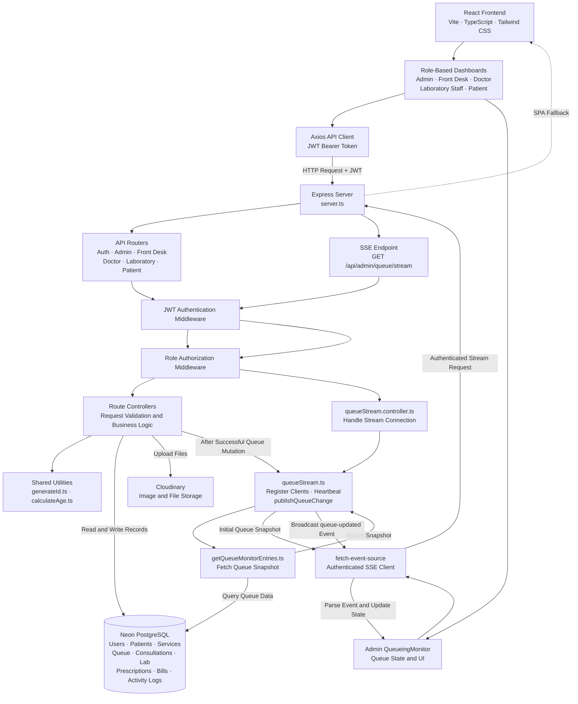

# TechCare: Cloud-Based Integrated Information System for Reyna G. Diagnostic Medical Clinic

TechCare is a full-stack clinic management system designed to streamline patient registration, consultation and laboratory queueing, laboratory requests, billing, and administrative operations for Reyna G. Diagnostic Medical Clinic.

**Live Application:** [https://techcare-1.onrender.com/](https://techcare-1.onrender.com/)

## Group Members

- Dela Cruz, Marc Jodel
- De Guzman, Mike Cleo
- Geronga, Laurence Anthony
- Juan, Randy Jr.
- Matangob, Jiano Freo

## System Architecture

The following diagram illustrates the frontend, backend, middleware, database, external services, and SSE-based queue monitoring.

## Documentation

For detailed setup and deployment instructions, see:

**[TechCare Setup and Deployment Notes](docs/SETUP.md)**

