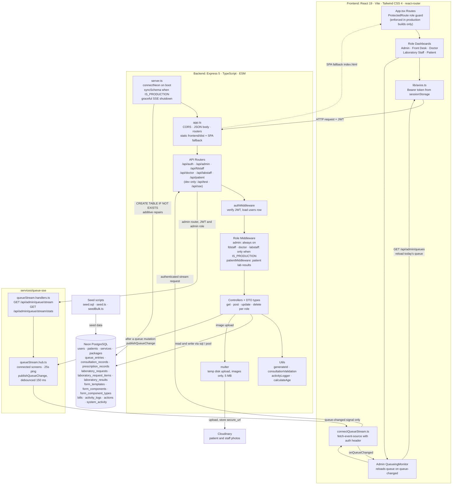

<h1 align="center">TechCare: Cloud-Based Integrated Clinic Information System</h1>

  

  
    
  
  
  
  

  <a href="https://techcare-1.onrender.com/">
    <strong>Live Application</strong>
  </a>
  ·
  <a href="docs/SETUP.md">
    <strong>Setup Documentation</strong>
  </a>

---

TechCare is a full-stack clinic management system designed to streamline patient registration, consultation and laboratory queueing, laboratory requests, billing, and administrative operations for Reyna G. Diagnostic Medical Clinic.

## Group Members

- Dela Cruz, Marc Jodel
- De Guzman, Mike Cleo
- Geronga, Laurence Anthony
- Juan, Randy Jr.
- Matangob, Jiano Freo

## System Architecture

The diagram below reflects the code as it exists today: the React role dashboards, the Express 5 API with its JWT and role middleware, the five role routers, the SSE-based live queue monitor, the PostgreSQL schema, and the external services.

