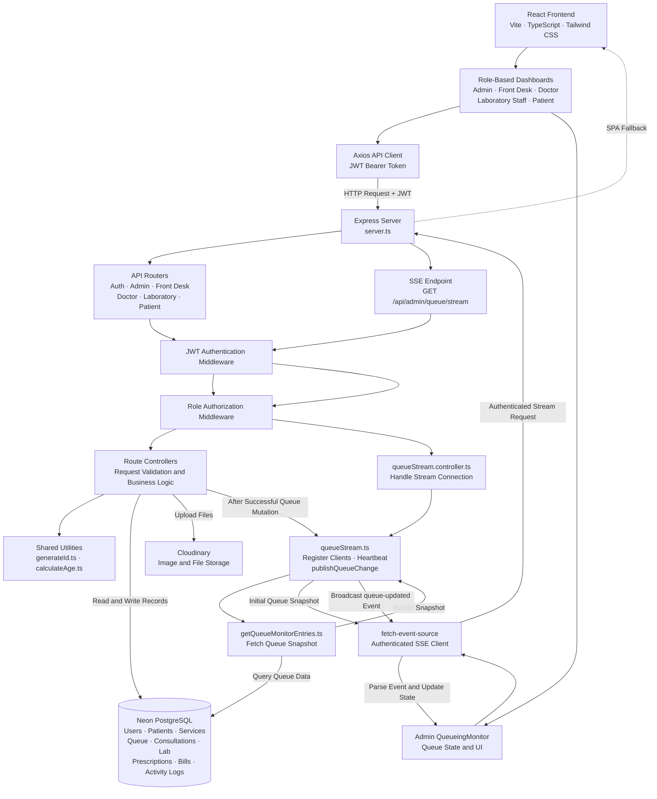

# TechCare: Cloud-Based Integrated Information System for Reyna G. Diagnostic Medical Clinic

TechCare is a full-stack clinic management system designed to streamline patient registration, consultation and laboratory queueing, laboratory requests, billing, and administrative operations for Reyna G. Diagnostic Medical Clinic.

**Live Application:** [https://techcare-1.onrender.com/](https://techcare-1.onrender.com/)

## Group Members

- Dela Cruz, Marc Jodel
- De Guzman, Mike Cleo
- Geronga, Laurence Anthony
- Juan, Randy Jr.
- Matangob, Jiano Freo

## Technology Stack

- **Frontend:** React 19, TypeScript, Vite, Tailwind CSS
- **Backend:** Node.js, Express 5, TypeScript, ESM
- **Database:** Neon PostgreSQL
- **Authentication:** JSON Web Tokens (JWT)
- **Deployment:** Render
- **File and Image Services:** Cloudinary
- **Real-Time Updates:** Server-Sent Events (SSE)
- **HTTP Client:** Axios
- **SSE Client:** `@microsoft/fetch-event-source`

## System Architecture

The following diagram illustrates the frontend, backend, middleware, database, external services, and SSE-based queue monitoring.

### Real-Time Queue Monitoring

TechCare uses Server-Sent Events (SSE) to deliver queue updates from the backend to the admin queue monitor.

- **Connection:** The frontend uses `@microsoft/fetch-event-source` to establish an authenticated streaming request.
- **Authentication:** The request carries a JWT in the `Authorization` header.
- **Queue snapshots:** The backend retrieves queue entries and sends JSON data through SSE events.
- **Live updates:** Successful queue mutations trigger broadcasts to connected clients.
- **Heartbeat and reconnection:** The stream maintains its connection with heartbeat messages, while the client can reconnect after interruptions.

Regular queue operations continue to use HTTP API requests. SSE provides the server-to-client update channel; it does not replace the API operations that modify queue records.

## Documentation

For detailed setup and deployment instructions, see:

**[TechCare Setup and Deployment Notes](docs/SETUP.md)**

The documentation covers:

- Backend and frontend environment variables
- Local monolithic and distributed configurations
- Production deployment on Render
- Database seeding commands and safety considerations
- TypeScript checks and production builds
- Troubleshooting common deployment issues
- Security and deployment checklists

## Quick Start

1. Clone the repository.
2. Install backend and frontend dependencies.
3. Configure `backend/.env` with the database connection, authentication secrets, CORS settings, and any required Cloudinary credentials.
4. Configure `frontend/.env.local` with the appropriate development flag and API base URL.
5. Initialize the development database using the appropriate seed command.
6. Start the backend and frontend using the scripts defined in their respective `package.json` files.

Follow the [Setup and Deployment Notes](docs/SETUP.md) for the complete instructions and deployment-specific configuration.

## Security

- Never commit `.env` files or secrets.
- Keep database credentials, JWT secrets, refresh-token secrets, and Cloudinary API secrets on the backend.
- Configure CORS to allow only the intended frontend origins.
- Avoid running destructive seed commands against production data.
- Verify that import paths match committed file and directory capitalization before deployment.
